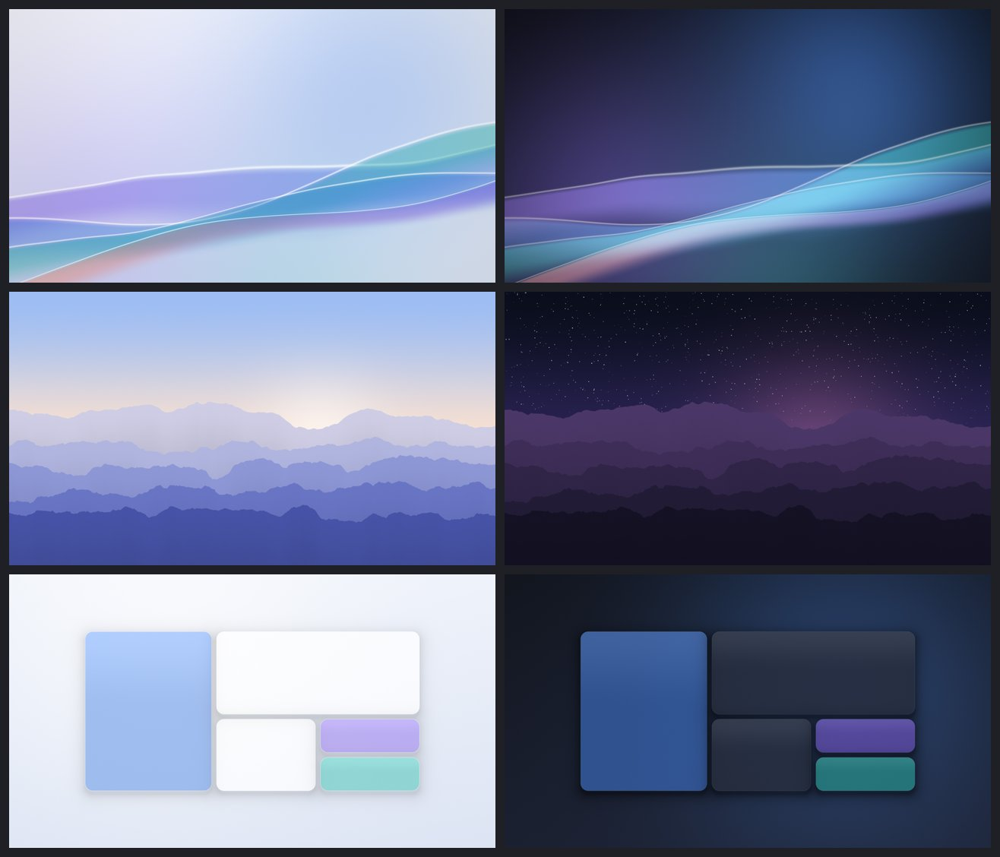

# /branding

Owner: `theme-designer` (see docs/agents.md). Other agents: open an issue instead of editing here.

## Wallpapers (`wallpapers/`)



Original art, **CC-BY-SA-4.0** (see `REUSE.toml`). Three Plasma wallpaper packages, each with light (`contents/images/`)
and dark (`contents/images_dark/`) versions at 3840×2160 and 3840×2400. Plasma picks the variant that matches the colour scheme.

| Package | Look |
|---|---|
| `ZeeOS` (default) | Translucent silk ribbons over a soft bloom, in the ZeeOS palette (accent `#3D7AE0`) |
| `ZeeOS-Horizon` | Layered ridges: dawn (light) / starry dusk (dark) |
| `ZeeOS-Tiles` | Rounded glass tiles in a snap-layout arrangement |

They are generated, not drawn: `src/render.py` (fixed seeds, no third-party assets) writes every image and `metadata.json`.
To change them, edit the script and re-render:

```bash
python3 -m venv .venv && .venv/bin/pip install numpy pillow
.venv/bin/python branding/wallpapers/src/render.py            # all packages
.venv/bin/python branding/wallpapers/src/render.py --preview  # quick small previews
```

`build/build-iso.sh` copies every package here into `/usr/share/wallpapers/` in the image. The desktop overlay makes `ZeeOS`
the default for the desktop and the lock screen.
