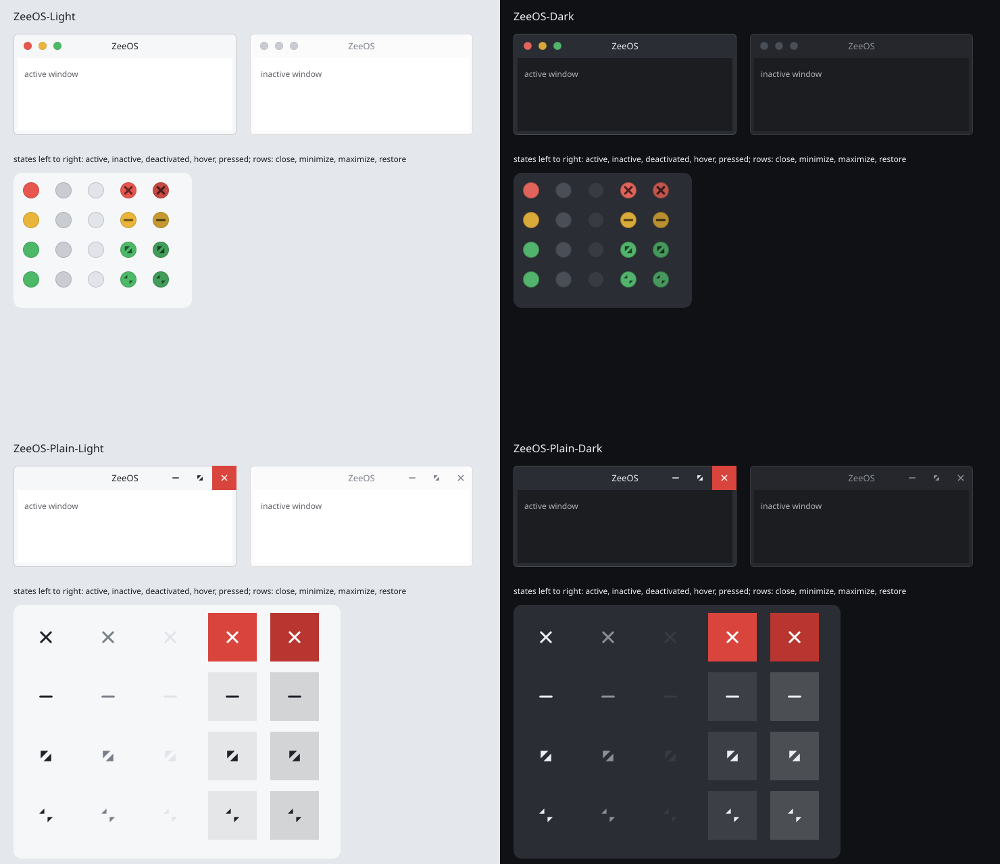

# Aurorae window decoration (`aurorae/`)



Original art, **CC-BY-SA-4.0** (see `REUSE.toml`). Four Aurorae SVG themes; each directory installs to
`/usr/share/aurorae/themes/<name>/`. Aurorae SVG themes carry fixed colours, so light and dark are separate themes.

| Theme | Buttons | For |
|---|---|---|
| `ZeeOS-Light`, `ZeeOS-Dark` | Round traffic-light dots (close, minimize, maximize), symbol on hover | Mac and Hybrid layouts |
| `ZeeOS-Plain-Light`, `ZeeOS-Plain-Dark` | Flat full-height buttons, close turns red on hover | Windows layout |

Frame: 36 px title bar, 6 px borders, 6 px corner radius, 1 px outline. Each theme has `decoration.svg` (active and
inactive frame), one SVG per button (`close`, `minimize`, `maximize`, `restore`, `alldesktops`, `keepabove`,
`keepbelow`, `shade`, `help`; five states each), `<name>rc` (layout) and `metadata.json`.

Nothing is traced or borrowed: `src/render.py` (standard library only) draws every file from plain geometry. The
traffic-light colours are ZeeOS's own. To change the art, edit the script and re-run it:

```bash
python3 branding/aurorae/src/render.py --preview   # writes the themes and src/preview.svg
rsvg-convert -o branding/aurorae/preview.png branding/aurorae/src/preview.svg
```

The preview is a mock-up built from the same button drawings, not a KWin screenshot. Not yet checked in KWin:
the Aurorae element names and `<name>rc` keys follow the Aurorae SVG format but have not been loaded in a running
session. Installing the themes into the image and pointing the layouts at them is P3-10 (desktop-shell).
