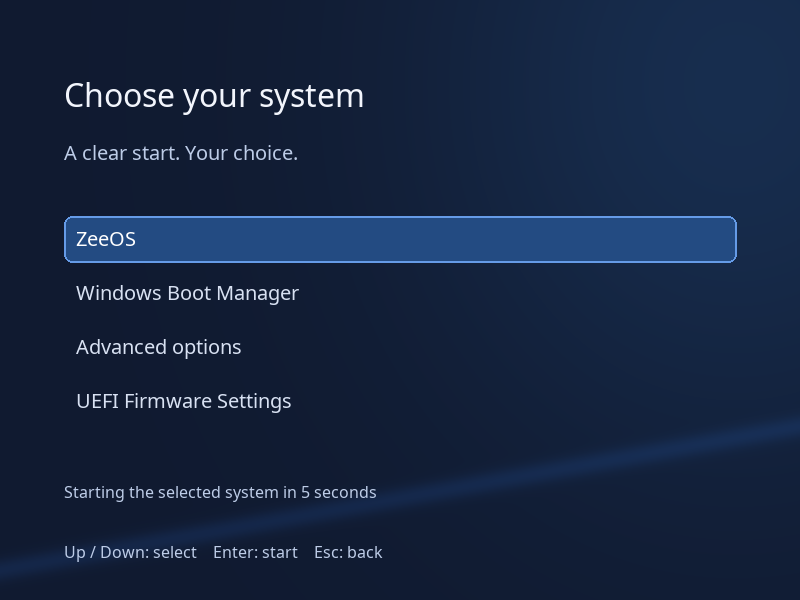
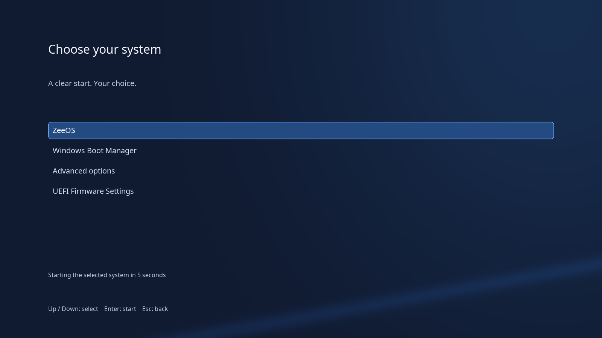

# GRUB artwork (#182)

Original dark background and selection tiles, with high-contrast text and a layout designed for 800×600
and larger displays. No third-party icons or logo artwork. Noto Sans is redistributed under OFL-1.1;
its upstream copyright and license are in `LICENSES/OFL-1.1.txt`. All text is ASCII so the generated
font subset covers every theme label. Per the owner's #200 decision and ADR-0009, keep the ASCII
PF2 subset. The installer-owned boot-menu work (#179) must keep generated entry titles and messages
ASCII too; user-supplied non-ASCII labels are not covered by these fonts. No Arabic/RTL support is claimed.





The 1600×1200 background is center-cropped to the display's aspect ratio before proportional scaling.
At 1600×900 this removes 150 pixels from each of the top and bottom edges; at 800×600 the entire source
is scaled by one half. Text and menu layout stay anchored to screen percentages. Both previews use
the actual `background.png` with the same crop geometry, rather than regenerating artwork at each size.

The previews are **design mockups**, not screenshots from GRUB. Entries are illustrative: the theme
only displays entries already supplied by `grub.cfg`. It never adds a Windows entry or changes the
default, timeout, installer, ESP, NVRAM, or signed Fedora bootloader binaries.

## Reproduce

```sh
python3 -m pip install Pillow
python3 branding/grub/src/render.py
bash branding/grub/src/build-fonts.sh # Fedora grub2-mkfont 2.12
```

Font source: [Noto Sans Regular](https://github.com/notofonts/noto-fonts/blob/main/hinted/ttf/NotoSans/NotoSans-Regular.ttf),
SHA256 `b85c38ecea8a7cfb39c24e395a4007474fa5a4fc864f6ee33309eb4948d232d5`.
The source font is vendored; regeneration requires no download. Generated PF2 files use the original
font name, `Noto Sans Regular`, at 16, 20 and 32 pixels.

## Integration handoff (installer/build owners)

Copy `theme.txt`, `background.png`, `selection_*.png` and `fonts/` together into the installed theme
directory. Load all three PF2 files before selecting `theme.txt`, then use the existing signed GRUB
graphics support. Set `GRUB_THEME` through the installer-owned configuration. This PR supplies assets
only and does not enable them. Reference: [GNU GRUB theme format](https://www.gnu.org/software/grub/manual/grub/html_node/Theme-file-format.html).

A graphical theme cannot render in firmware text mode. Keep GRUB's ordinary text menu as the fallback;
use `GRUB_COLOR_NORMAL=light-gray/black` and `GRUB_COLOR_HIGHLIGHT=white/blue` in installer-owned config.
Do not force graphics output if video or font loading fails. Verify both graphical 800×600 and text
fallback paths in a disposable VM before shipping. These guest checks are pending, not local passes.
